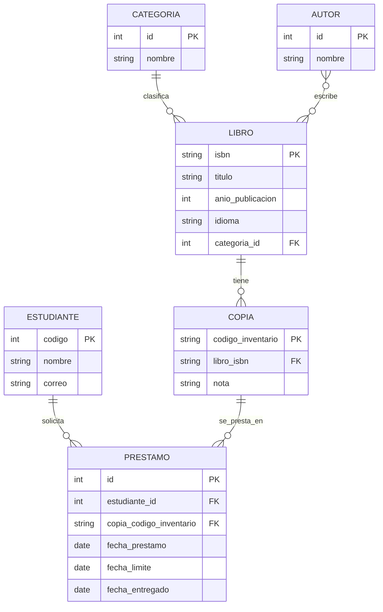

# Biblioteca UFPS: Modelos, Admin y ORM con Django

Proyecto desarrollado para la asignatura **Programación Web UFPS** (Profesor Daniel Esteban). Implementación de la base de datos relacional, panel de control administrativo y consultas optimizadas mediante el ORM de Django para el sistema de biblioteca de la Universidad Francisco de Paula Santander.

---

## 1. Título y Descripción

* **Nombre del proyecto:** Sistema de Gestión de Biblioteca Universitaria UFPS
* **Descripción:**  
  Este proyecto implementa una solución web relacional construida sobre Django para digitalizar la gestión integral de la biblioteca de la universidad. Permite al personal bibliotecario dejar de lado el registro tradicional en cuadernos físicos, automatizando la administración del inventario de libros y copias físicas, la clasificación por autores y categorías, el registro de estudiantes, y el control riguroso de préstamos y devoluciones.  
  El sistema resuelve problemáticas críticas como la distinción inequívoca entre la obra intelectual y sus múltiples ejemplares físicos tangibles, la consulta en tiempo real de copias disponibles y el cumplimiento estricto de reglas de integridad (impidiendo que una misma copia física sea prestada en paralelo a dos personas).

---

## 2. Tecnologías

* **Python:** 3.14 (compatible con Python 3.10+)
* **Django:** 6.1.3 (framework web de alto nivel, incluyendo Django ORM y Django Admin)
* **Base de Datos:** SQLite3 (motor relacional por defecto integrado en Django)
* **Dependencias principales:** `asgiref==3.13.0`, `Django==6.1.3`, `sqlparse==0.6.1`, `tzdata==2026.2`

---

## 3. Instalación y Ejecución

Sigue estos pasos para clonar, configurar y ejecutar el proyecto en tu máquina local desde cero:

### 1. Clonar el repositorio y entrar al directorio
```bash
git clone https://github.com/diegoardila05/ActividadDjango.git
cd ActividadDjango
```

### 2. Crear y activar el entorno virtual
En Linux / macOS:
```bash
python3 -m venv .venv
source .venv/bin/activate
```
En Windows:
```cmd
python -m venv .venv
.venv\Scripts\activate
```

### 3. Instalar las dependencias
```bash
pip install -r requirements.txt
```

### 4. Aplicar las migraciones a la base de datos
```bash
python manage.py migrate
```

### 5. Poblar la base de datos con datos de prueba iniciales
Se incluye un script que precarga automáticamente categorías, autores, libros, copias físicas, estudiantes y préstamos con diferentes estados:
```bash
python poblar_datos.py
```

### 6. Crear un superusuario para acceder al panel de administración
```bash
python manage.py createsuperuser
```
*(Ingresa un nombre de usuario, correo electrónico y contraseña cuando la consola te lo pida)*.

### 7. Iniciar el servidor local de desarrollo
```bash
python manage.py runserver
```

Abre tu navegador e ingresa a:  
**`http://127.0.0.1:8000/admin/`**  
Inicia sesión con las credenciales creadas en el paso 6.

---

## 4. Estructura del Proyecto

Organización de los módulos, carpetas y archivos principales:

```text
ActividadDjango/
├── config/                     # Paquete de configuración principal del proyecto Django
│   ├── __init__.py
│   ├── asgi.py                 # Punto de entrada para servidores compatibles con ASGI
│   ├── settings.py             # Configuración global (aplicaciones, base de datos, localización)
│   ├── urls.py                 # Enrutador principal de URLs del proyecto (panel /admin/)
│   └── wsgi.py                 # Punto de entrada para servidores compatibles con WSGI
├── biblioteca/                 # Aplicación Django que gestiona la lógica de la biblioteca
│   ├── migrations/             # Historial de migraciones del esquema de la base de datos
│   │   ├── 0001_initial.py
│   │   ├── 0002_libro_idioma.py
│   │   └── 0003_alter_prestamo_fecha_prestamo.py
│   ├── __init__.py
│   ├── admin.py                # Personalización avanzada del panel administrativo de Django
│   ├── apps.py                 # Configuración de metadatos de la app biblioteca
│   ├── models.py               # Definición de los 6 modelos relacionales y sus restricciones
│   ├── tests.py                # Pruebas unitarias
│   └── views.py                # Vistas HTTP de la aplicación
├── manage.py                   # Script de línea de comandos de Django
├── poblar_datos.py             # Script para sembrar registros iniciales de prueba
├── requirements.txt            # Dependencias fijadas para el entorno Python
├── .gitignore                  # Reglas de exclusión para Git (.venv, pycache, sqlite3, pdfs)
└── README.md                   # Documentación integral del repositorio
```

---

## 5. Modelo de Datos

El diseño relacional se compone de seis entidades derivadas del análisis del enunciado de la biblioteca universitaria:

### 1. Diagrama Entidad-Relación (`erDiagram` con Mermaid)



### 2. Explicación de relaciones y cardinalidades

1. **`CATEGORIA ||--o{ LIBRO : clasifica`**:  
   Una categoría temática clasifica cero o muchos libros (`o{`), mientras que cada libro pertenece de forma obligatoria a exactamente una sola categoría (`||`), implementado como `ForeignKey(Categoria, on_delete=models.PROTECT)`.
2. **`AUTOR }o--o{ LIBRO : escribe`**:  
   Un autor puede haber escrito cero o muchos libros (`}o`), y un libro puede haber sido escrito por uno o más autores en coautoría (`o{`), implementado mediante `ManyToManyField(Autor)`.
3. **`LIBRO ||--o{ COPIA : tiene`**:  
   Un libro como concepto editorial puede tener cero o múltiples ejemplares físicos tangibles en estantería (`o{`), y cada copia física pertenece obligatoriamente a una única obra (`||`), mediante `ForeignKey(Libro, on_delete=models.PROTECT)`.
4. **`ESTUDIANTE ||--o{ PRESTAMO : solicita`**:  
   Un estudiante registrado en el sistema puede solicitar a lo largo del tiempo cero o muchos préstamos (`o{`), y cada préstamo está asociado de forma obligatoria a un único estudiante (`||`), mediante `ForeignKey(Estudiante, on_delete=models.PROTECT)`.
5. **`COPIA ||--o{ PRESTAMO : se_presta_en`**:  
   Un ejemplar o copia física puede prestarse cero o muchas veces en su ciclo de vida (`o{`), y cada registro de préstamo involucra exactamente a una copia física (`||`), mediante `ForeignKey(Copia, on_delete=models.PROTECT)`.

---

### 3. Regla de negocio: "Una copia no puede estar prestada a dos personas al mismo tiempo"

Para garantizar que un ejemplar físico no pueda ser prestado simultáneamente a dos usuarios, se analizaron las dos alternativas que provee Django:

| Enfoque | Ventajas | Limitaciones |
| :--- | :--- | :--- |
| **Validación en modelo con `clean()`** | Permite personalizar el error en la interfaz de formularios y admin. | **Vulnerable fuera del admin:** No se dispara si se guarda desde el shell con `.save()`, scripts externos o APIs, a menos que se llame explícitamente `full_clean()`. |
| **Restricción en BD con `UniqueConstraint` (Elegida)** | **Integridad absoluta garantizada por el motor SQL:** Aplica sin importar si el dato entra por el admin, shell, scripts masivos o servicios externos. | Requiere definir la condición lógica dentro de `class Meta`. |

#### Decisión adoptada y código implementado
Se implementó mediante un **`UniqueConstraint` condicional** dentro de `class Meta` en el modelo `Prestamo`:

```python
class Meta:
    constraints = [
        models.UniqueConstraint(
            fields=["copia"],
            condition=models.Q(fecha_entregado__isnull=True),
            name="una_copia_por_prestamo_activo",
            violation_error_message="Esta copia ya tiene un prestamo activo"
        )
    ]
```

> **Justificación técnica:**  
> Se eligió la restricción a nivel de base de datos (`constraints`) porque garantiza que la regla de negocio nunca se viole, protegiendo la base de datos de inconsistencias ante cualquier vía de inserción. Además, su naturaleza declarativa en Django genera la restricción nativa en SQL mediante las migraciones.

#### Evidencia de funcionamiento
Al intentar registrar un segundo préstamo para una copia física cuya fecha de entrega aún está vacía (`fecha_entregado is NULL`), Django y la base de datos bloquean la operación mostrando:
```text
Please correct the error below.
* Esta copia ya tiene un préstamo activo
```

---

## 6. Panel de Administración

El panel de administración se personalizó para ofrecer una experiencia intuitiva, clara y eficiente, adaptada a las necesidades de una bibliotecaria sin conocimientos técnicos de bases de datos.

### 1. Resumen de personalizaciones por modelo

| Modelo | `list_display` (Columnas) | `search_fields` (Búsqueda) | `list_filter` (Filtros laterales) | Características especiales |
| :--- | :--- | :--- | :--- | :--- |
| **`Categoria`** | `id`, `nombre` | `nombre` | — | Búsqueda rápida por nombre. |
| **`Autor`** | `id`, `nombre` | `nombre` | — | Búsqueda rápida por autor. |
| **`Libro`** | `titulo`, `isbn`, `categoria`, `anio_publicacion` | `titulo`, `isbn`, `autores__nombre` | `categoria`, `anio_publicacion`, `idioma` | **`inlines = [CopiaInline]`** (gestión de copias físicas directamente desde la página del libro). |
| **`Copia`** | `codigo_inventario`, `libro`, `nota` | `codigo_inventario`, `libro__titulo` | `nota` | Búsqueda cruzada por código o título del libro. |
| **`Estudiante`** | `codigo`, `nombre`, `correo` | `codigo`, `nombre`, `correo` | — | Búsqueda rápida por código o nombre del alumno. |
| **`Prestamo`** | `estudiante`, `copia`, `fecha_prestamo`, `fecha_limite`, `fecha_entregado` | `estudiante__nombre`, `estudiante__codigo`, `copia__codigo_inventario`, `copia__libro__titulo` | `fecha_prestamo`, `fecha_limite`, `EstadoPrestamoFiltro` | **`readonly_fields = ('fecha_prestamo',)`** y acción masiva **`marcar_devueltos`**. |

---

### 2. Solución al Mini Reto: La Bibliotecaria

Para que la bibliotecaria trabaje con agilidad y sin confusiones, se implementaron cuatro soluciones:

1. **Búsqueda inmediata de estudiantes:**  
   En `PrestamoAdmin` y `EstudianteAdmin`, la caja de búsqueda permite encontrar alumnos tipeando su nombre o su código estudiantil (`search_fields = ('estudiante__nombre', 'estudiante__codigo')`).
2. **Diferenciación inequívoca de copias físicas:**  
   Se definió un método `__str__` descriptivo en `Copia` (`"Copia SO-001 del libro Cien años de soledad"`) e inline tabular dentro de `Libro`, evitando que se confundan copias físicas de libros distintos al momento de prestarlas.
3. **Filtro intuitivo de estado (`EstadoPrestamoFiltro`):**  
   Por defecto, filtrar en Django por `fecha_entregado = None` muestra etiquetas poco claras como *"No date"*. Se creó un `SimpleListFilter` personalizado que expone dos opciones legibles:
   * **`Sin entregar:`** filtra préstamos con `fecha_entregado__isnull=True`.
   * **`Entregado:`** filtra préstamos con `fecha_entregado__isnull=False`.
4. **Acción masiva para devolver libros (`marcar_devueltos`):**  
   Permite seleccionar una o varias filas de préstamos pendientes en la lista y, con un solo clic en la barra de acciones del admin, asignar automáticamente la fecha actual (`date.today()`) a `fecha_entregado`.

---

## 7. Consultas con el ORM

Para validar el modelo y dominar el ORM de Django, se ejecutaron 10 retos de consulta en la consola interactiva (`python manage.py shell`), contrastando la predicción previa con el resultado real:

### Reto 1: Crear un autor, un libro de ese autor y dos copias físicas desde el shell
* **Código:**
  ```python
  from biblioteca.models import Categoria, Autor, Libro, Copia
  cat = Categoria.objects.get(nombre="Novela")
  autor = Autor.objects.create(nombre="Isaac Asimov")
  libro = Libro.objects.create(
      isbn="9780553293357",
      titulo="Fundación",
      anio_publicacion=1951,
      categoria=cat,
      idioma="Español"
  )
  libro.autores.add(autor)
  copia1 = Copia.objects.create(codigo_inventario="FD-001", libro=libro, nota="nuevo")
  copia2 = Copia.objects.create(codigo_inventario="FD-002", libro=libro, nota="usado")
  ```
* **Predicción:** Se creará la instancia del autor 'Isaac Asimov', el libro 'Fundación' asociado a dicho autor mediante la relación ManyToMany, y dos copias físicas ('FD-001' y 'FD-002') asociadas a ese libro.
* **Resultado:**
  * Autor: `<Autor: Isaac Asimov>`
  * Libro: `<Libro: Fundación>`
  * Copias: `<Copia: Copia FD-001 del libro Fundación>`, `<Copia: Copia FD-002 del libro Fundación>`

---

### Reto 2: Obtener todos los libros de un autor, buscando al autor por su nombre
* **Código:**
  ```python
  from biblioteca.models import Libro
  libros = Libro.objects.filter(autores__nombre="Robert C. Martin")
  print(list(libros))
  ```
* **Predicción:** Devolverá un QuerySet con los libros escritos por Robert C. Martin: 'Clean Code' y 'Clean Architecture'.
* **Resultado:**
  `[<Libro: Clean Code>, <Libro: Clean Architecture>]`

---

### Reto 3: Obtener los libros cuyo título contiene cierta palabra, sin importar mayúsculas
* **Código:**
  ```python
  from biblioteca.models import Libro
  libros = Libro.objects.filter(titulo__icontains="clean")
  print(list(libros))
  ```
* **Predicción:** El lookup `__icontains` filtrará insensible a mayúsculas/minúsculas. Al buscar `"clean"`, traerá 'Clean Code' y 'Clean Architecture'.
* **Resultado:**
  `[<Libro: Clean Code>, <Libro: Clean Architecture>]`

---

### Reto 4: Obtener las copias físicas disponibles (las que no tienen ningún préstamo activo)
* **Código:**
  ```python
  from biblioteca.models import Copia, Prestamo
  prestamos_activos = Prestamo.objects.filter(fecha_entregado__isnull=True)
  copias_disponibles = Copia.objects.exclude(prestamo__in=prestamos_activos)
  print(list(copias_disponibles))
  ```
* **Predicción:** Si se filtrara ingenuamente por `prestamo__fecha_entregado__isnull=False`, las copias nuevas sin historial quedarían fuera por el `LEFT JOIN`. Al excluir explícitamente las copias vinculadas a préstamos activos (`fecha_entregado is NULL`), obtendremos las copias libres: CC-002, CA-001, FD-001, FD-002.
* **Resultado:**
  `[<Copia: Copia CC-002 del libro Clean Code>, <Copia: Copia CA-001 del libro Clean Architecture>, <Copia: Copia FD-001 del libro Fundación>, <Copia: Copia FD-002 del libro Fundación>]`

---

### Reto 5: Obtener los estudiantes que tienen al menos un préstamo activo, sin repetir estudiantes
* **Código:**
  ```python
  from biblioteca.models import Estudiante, Prestamo
  prestamos_activos = Prestamo.objects.filter(fecha_entregado__isnull=True)
  estudiantes_activos = Estudiante.objects.filter(prestamo__in=prestamos_activos).distinct()
  print(list(estudiantes_activos))
  ```
* **Predicción:** Devolverá los estudiantes con préstamos pendientes de devolución. Gracias a `.distinct()`, Juan Pérez (quien tiene dos préstamos activos) solo aparecerá una vez. Laura Torres no aparecerá porque nunca ha pedido préstamos.
* **Resultado:**
  `[<Estudiante: 1151001 - Carlos Gómez>, <Estudiante: 1151002 - María Rodríguez>, <Estudiante: 1151003 - Juan Pérez>]`

---

### Reto 6: Calcular cuántos préstamos ha hecho cada estudiante, contando los ya devueltos
* **Código:**
  ```python
  from django.db.models import Count
  from biblioteca.models import Estudiante
  estudiantes_conteo = Estudiante.objects.annotate(total_prestamos=Count("prestamo"))
  for e in estudiantes_conteo:
      print(f"{e.nombre} ({e.codigo}): {e.total_prestamos} préstamo(s)")
  ```
* **Predicción:** Se agregará a cada estudiante el conteo histórico de sus préstamos usando `annotate(Count('prestamo'))`. Carlos: 2, María: 2, Juan: 2, Laura: 0.
* **Resultado:**
  * Carlos Gómez (1151001): 2 préstamo(s)
  * María Rodríguez (1151002): 2 préstamo(s)
  * Juan Pérez (1151003): 2 préstamo(s)
  * Laura Torres (1151004): 0 préstamo(s)

---

### Reto 7: Encontrar el libro más prestado de la biblioteca
* **Código:**
  ```python
  from django.db.models import Count
  from biblioteca.models import Libro
  libro_top = Libro.objects.annotate(total_prestamos=Count("copia__prestamo")).order_by("-total_prestamos").first()
  print(f"{libro_top.titulo} con {libro_top.total_prestamos} préstamos")
  ```
* **Predicción:** Atravesando la relación inversa `copia__prestamo`, contará los préstamos de todas las copias de cada libro. 'Cien años de soledad' acumuló 3 préstamos, por lo que encabezará el resultado.
* **Resultado:**
  `Cien años de soledad con 3 préstamos`

---

### Reto 8: Obtener los estudiantes que nunca han pedido un préstamo
* **Código:**
  ```python
  from biblioteca.models import Estudiante
  sin_prestamo = Estudiante.objects.filter(prestamo__isnull=True)
  print(list(sin_prestamo))
  ```
* **Predicción:** Filtrando por la relación inversa nula (`prestamo__isnull=True`), devolverá a Laura Torres, quien no tiene registros de préstamo.
* **Resultado:**
  `[<Estudiante: 1151004 - Laura Torres>]`

---

### Reto 9: Marcar un préstamo como devuelto con la fecha de hoy y comprobar que el cambio quedó guardado
* **Código:**
  ```python
  from datetime import date
  from biblioteca.models import Prestamo
  prestamo = Prestamo.objects.filter(fecha_entregado__isnull=True).first()
  print("Antes:", prestamo.id, prestamo.fecha_entregado)
  prestamo.fecha_entregado = date.today()
  prestamo.save()
  prestamo.refresh_from_db()
  print("Después:", prestamo.id, prestamo.fecha_entregado)
  ```
* **Predicción:** Inicialmente `fecha_entregado` es `None`. Tras asignarle `date.today()` y hacer `save()`, al recargar el registro con `refresh_from_db()`, el valor almacenado reflejará la fecha actual.
* **Resultado:**
  * `Antes: 1 None`
  * `Después: 1 2026-11-06` (fecha confirmada y persistida en BD).

---

### Reto 10: Borrar un autor y observar qué pasa con sus libros (relación y `on_delete`)
* **Código:**
  ```python
  from biblioteca.models import Autor, Libro
  autor_asimov = Autor.objects.get(nombre="Isaac Asimov")
  libro_fundacion = Libro.objects.get(isbn="9780553293357")
  print("Autores antes de borrar:", list(libro_fundacion.autores.all()))
  autor_asimov.delete()
  print("¿Existe el libro 'Fundación'?:", Libro.objects.filter(isbn="9780553293357").exists())
  libro_fundacion.refresh_from_db()
  print("Autores después de borrar:", list(libro_fundacion.autores.all()))
  ```
* **Predicción:** Al borrar el autor 'Isaac Asimov', el libro 'Fundación' no se borrará, sino que permanecerá en la base de datos con su lista de autores vacía.
* **Resultado:**
  * Autores antes de borrar: `[<Autor: Isaac Asimov>]`
  * ¿Existe el libro 'Fundación'?: `True`
  * Autores después de borrar: `[]`
* **Explicación técnica:** La relación entre `Libro` y `Autor` está definida como `ManyToManyField(Autor)`. En las bases de datos relacionales y en Django, esto genera una tabla intermedia independiente (`biblioteca_libro_autores`). Al borrar un `Autor`, Django elimina en cascada únicamente las filas en dicha tabla intermedia. La entidad `Libro` no se elimina porque tiene ciclo de vida autónomo. Por esta razón, los campos `ManyToManyField` en Django no requieren ni aceptan el parámetro `on_delete` directamente en el campo.

---

## 8. Optimización (Reto de Consultas Repetidas N+1)

El problema de las consultas N+1 ocurre cuando se itera sobre una lista de $N$ objetos y, por cada uno, se accede a un modelo relacionado que no fue precargado, obligando al ORM a disparar una consulta SQL adicional por cada elemento del bucle ($1 + N$ consultas).

Para medir con precisión la cantidad de consultas SQL ejecutadas se utilizó `CaptureQueriesContext(connection)` desde el shell de Django.

---

### Caso 1: Recorrer préstamos accediendo al estudiante y al libro de la copia

#### 1. Código sin optimizar
```python
from django.db import connection
from django.test.utils import CaptureQueriesContext
from biblioteca.models import Prestamo

with CaptureQueriesContext(connection) as ctx:
    for p in Prestamo.objects.all():
        print(p.estudiante.nombre, p.copia.libro.titulo)

print(len(ctx), "consultas")
```
* **Predicción antes de medir:**
  * Tenemos 6 préstamos ($N = 6$).
  * 1 consulta inicial para obtener todos los préstamos: `SELECT * FROM biblioteca_prestamo`.
  * Por cada iteración:
    * 1 consulta para resolver la ForeignKey `p.estudiante`.
    * 1 consulta para resolver la ForeignKey `p.copia`.
    * 1 consulta para resolver la ForeignKey `p.copia.libro`.
  * Predicción total: $1 + (6 \times 3) = 19$ consultas.
* **Medición real:** **19 consultas**.

#### 2. Corrección con `select_related`
Dado que `estudiante`, `copia` y `copia.libro` son relaciones `ForeignKey` (hacia un solo objeto), se pueden precargar mediante un solo `SQL JOIN`:
```python
with CaptureQueriesContext(connection) as ctx:
    for p in Prestamo.objects.select_related("estudiante", "copia__libro").all():
        print(p.estudiante.nombre, p.copia.libro.titulo)

print(len(ctx), "consultas")
```
* **Medición después de optimizar:** **1 consulta** (todas las tablas se unieron mediante un único `JOIN`).

---

### Caso 2: Mostrar cada libro con la lista de sus autores

#### 1. Código sin optimizar
```python
from django.db import connection
from django.test.utils import CaptureQueriesContext
from biblioteca.models import Libro

with CaptureQueriesContext(connection) as ctx:
    for libro in Libro.objects.all():
        autores = ", ".join([a.nombre for a in libro.autores.all()])
        print(f"{libro.titulo}: {autores}")

print(len(ctx), "consultas")
```
* **Predicción antes de medir:**
  * Tenemos 5 libros en la base de datos ($N = 5$).
  * 1 consulta inicial para traer todos los libros.
  * 1 consulta individual por cada libro para resolver `libro.autores.all()` mediante la tabla intermedia.
  * Predicción total: $1 + 5 = 6$ consultas.
* **Medición real:** **6 consultas**.

#### 2. Corrección con `prefetch_related`
Como la relación entre `Libro` y `Autor` es de muchos a muchos (`ManyToManyField`), se debe utilizar `prefetch_related`:
```python
with CaptureQueriesContext(connection) as ctx:
    for libro in Libro.objects.prefetch_related("autores").all():
        autores = ", ".join([a.nombre for a in libro.autores.all()])
        print(f"{libro.titulo}: {autores}")

print(len(ctx), "consultas")
```
* **Medición después de optimizar:** **2 consultas** (1 consulta para todos los libros y 1 consulta separada con `WHERE libro_id IN (...)` para traer todos sus autores; Django ensambla los objetos en memoria en Python).

---

### ¿Por qué `select_related` no sirve para el caso de los libros y sus autores?

`select_related` funciona ejecutando una cláusula `SQL JOIN` dentro de la misma sentencia. Esto funciona de manera óptima para relaciones hacia un único objeto (`ForeignKey` o `OneToOneField`), pues cada registro de la tabla principal se asocia con a lo sumo una fila de la tabla relacionada y el número de filas no se multiplica.

En cambio, en una relación muchos a muchos (`ManyToManyField`) como `Libro` y `Autor`:
1. Un `JOIN` generaría un producto cartesiano multiplicando las filas: si un libro tiene 4 autores, se generarían 4 filas duplicando todos los datos del libro en el cursor de la base de datos.
2. Si intentamos forzar `select_related('autores')`, Django lanza una excepción inmediata:  
   `django.core.exceptions.FieldError: Invalid field name(s) given in select_related: 'autores'. Choices are: categoria`
3. Django reserva `prefetch_related` para relaciones "a muchos", realizando exactamente 2 consultas limpias sin redundancia y mapeando las instancias en memoria.

---

### Tabla comparativa de optimización

| Consulta | Número de consultas antes | Número después | Técnica utilizada |
| :--- | :---: | :---: | :--- |
| **Préstamo con estudiante y libro** (`p.estudiante.nombre`, `p.copia.libro.titulo`) | 19 consultas | **1 consulta** | `select_related("estudiante", "copia__libro")` |
| **Libro con lista de autores** (`[a.nombre for a in libro.autores.all()]`) | 6 consultas | **2 consultas** | `prefetch_related("autores")` |

---

## 9. Uso de Inteligencia Artificial

* **Agente de IA utilizado:** Asistente de IA (Gemini / Antigravity).
* **Prompt solicitado:**
  ```text
  "Te paso mi archivo models.py de Django. Genera un diagrama Mermaid de tipo erDiagram con todos los modelos, sus campos principales y las relaciones con su cardinalidad. Devuelve solo el bloque de código."
  ```
* **Errores detectados y correcciones realizadas:**
  1. **Claves Primarias personalizadas:** El agente asumió por defecto campos autonuméricos `id PK` para todos los modelos. Se corrigió manualmente para reflejar las claves reales declaradas en `models.py`: `isbn` en `Libro`, `codigo_inventario` en `Copia` y `codigo` en `Estudiante`.
  2. **Cardinalidad del ManyToMany (`Autor` - `Libro`):** El modelo inicial del agente intentó colocar una relación de 1 a N (`AUTOR ||--o{ LIBRO`), lo cual rompía el concepto de coautoría. Se corrigió a muchos a muchos: `AUTOR }o--o{ LIBRO : escribe`.
  3. **Sentido invertido en la clave foránea `Copia` - `Libro`:** El agente colocó la relación al revés (`COPIA ||--o{ LIBRO`), sugiriendo que un ejemplar físico contenía muchos libros. Se corrigió colocando el lado del uno (`||`) en `LIBRO` y el de muchos (`o{`) en `COPIA`.
  4. **Campos opcionales (`null=True`):** En `Prestamo`, el campo `fecha_entregado` es opcional (`null=True, blank=True`). La IA lo había incluido como un campo normal sin distinguir su nulabilidad.
  5. **Cardinalidad de préstamos por copia física:** Al leer la regla de negocio *"una copia no puede estar prestada a dos personas al mismo tiempo"*, la IA intentó modelar una relación 1 a 1 (`COPIA ||--o| PRESTAMO`). Se corrigió a uno a muchos (`||--o{`), ya que una copia física acumula múltiples préstamos en su historial y la restricción de que solo uno esté activo en un momento dado corresponde a una restricción de integridad (`UniqueConstraint` condicional), no a una relación estructural 1 a 1.

---

## 10. Equipo y Reflexión

### Integrantes del equipo
* **Diego Fernando Ardila Bueno** (diego.ardilabueno@gmail.com)
* **Juan Barajas** (juanbq1989@gmail.com)
* **Julián Cáceres** (juliancaceres415@gmail.com)

---

### Respuestas a las preguntas de reflexión

#### 1. ¿Qué parte de su diseño cambió después de escribir las primeras consultas, y por qué?
Al realizar las consultas del Reto 4 (obtener copias físicas disponibles), la primera intuición era filtrar directamente con `Copia.objects.filter(prestamo__fecha_entregado__isnull=False)`. Sin embargo, al ejecutar la consulta nos percatamos de que eso excluía completamente a las copias nuevas que nunca habían sido prestadas, ya que no tenían ninguna fila asociada en la tabla de préstamos (`prestamo__fecha_entregado` resultaba en `NULL` debido al `LEFT OUTER JOIN`).  
Esto nos obligó a entender la diferencia entre *"estar devuelto"* y *"estar disponible"*. La solución requirió identificar primero los préstamos activos (`fecha_entregado__isnull=True`) y luego usar `Copia.objects.exclude(prestamo__in=prestamos_activos)`. Comprender esto nos confirmó que el diseño de modelos debe considerar siempre los casos límite donde no existen registros relacionados previos.

#### 2. ¿En qué se equivocó el agente con el diagrama y cómo lo notaron?
El agente cometió tres errores clave:
* Asumió que todas las tablas tenían `id` autoincremental como llave primaria, pasando por alto que en `models.py` definimos `isbn` en `Libro`, `codigo_inventario` en `Copia` y `codigo` en `Estudiante` con `primary_key=True`.
* Invirtió el sentido de la relación entre `Copia` y `Libro`.
* Intentó modelar la relación entre `Copia` y `Prestamo` como `1:1` condicionado por la regla de negocio, en lugar de `1:N`.

Lo notamos al realizar la lectura cruzada obligatoria entre el bloque `erDiagram` y las declaraciones de campos de `models.py`, verificando la dirección de las claves foráneas y la definición de las llaves primarias.

#### 3. ¿Qué decisión de su modelo defenderían ante otro grupo y cuál cambiarían si empezaran de nuevo?
* **Decisión que defenderíamos:** La implementación de la regla de la copia prestada mediante un **`UniqueConstraint` condicional** a nivel de base de datos (`condition=models.Q(fecha_entregado__isnull=True)`). Defenderíamos esta decisión con firmeza ante cualquier grupo que haya optado por validar únicamente con `clean()`, porque `clean()` solo protege entradas desde el panel admin o formularios web, pero deja la base de datos desprotegida ante inserciones directas con `.save()`, scripts de carga masiva, tareas en segundo plano o APIs. Con `UniqueConstraint`, la integridad es inviolable sin importar el origen de los datos.
* **Decisión que cambiaríamos:** El uso de claves primarias naturales de negocio (`isbn` para `Libro`, `codigo_inventario` para `Copia` y `codigo` para `Estudiante`). Aunque en un primer momento parecía lógico y ahorraba una columna, en entornos de producción es una mala práctica: si un estudiante cambia de código, un libro se registra con un ISBN equivocado o se actualiza la codificación del inventario físico, modificar una clave primaria que tiene llaves foráneas con `PROTECT` es una operación compleja y peligrosa. Si empezáramos de nuevo, usaríamos claves subrogadas autonuméricas estándar (`id` autoincremental) para todas las tablas, y colocaríamos `unique=True` en `isbn`, `codigo_inventario` y `codigo`.
